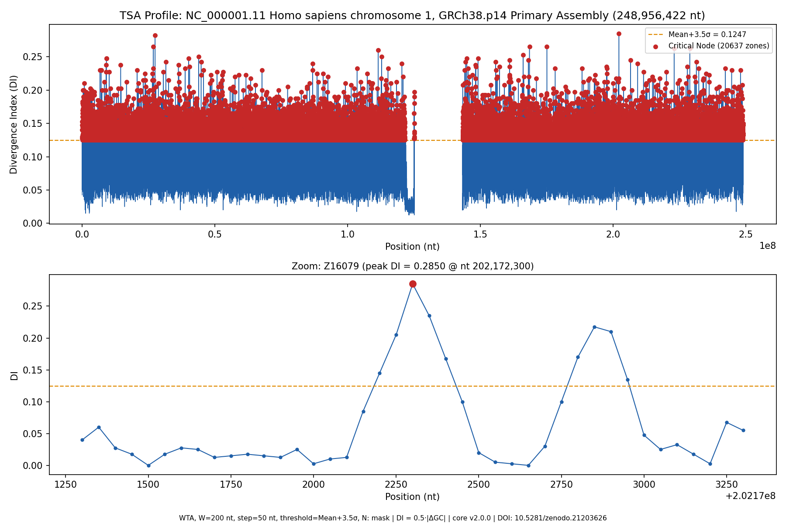
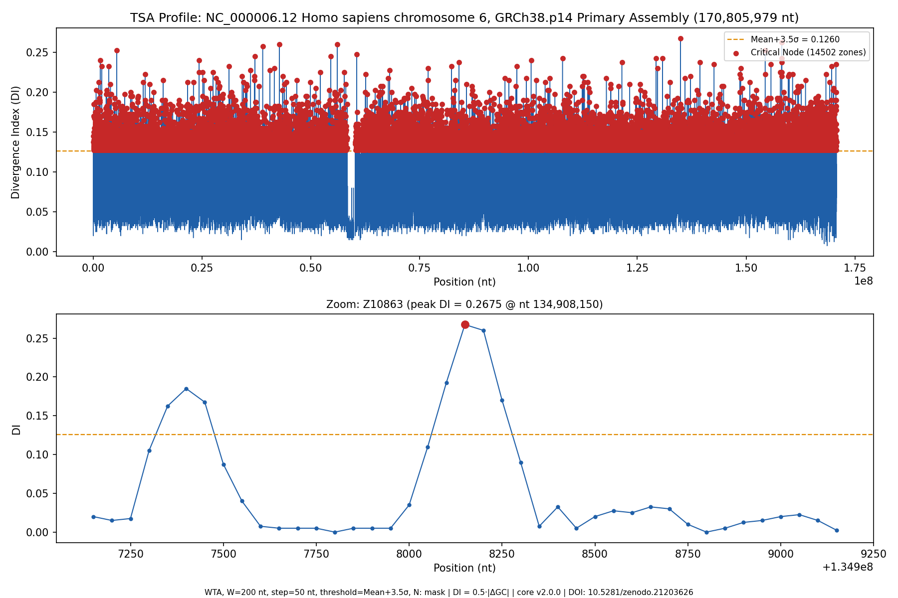
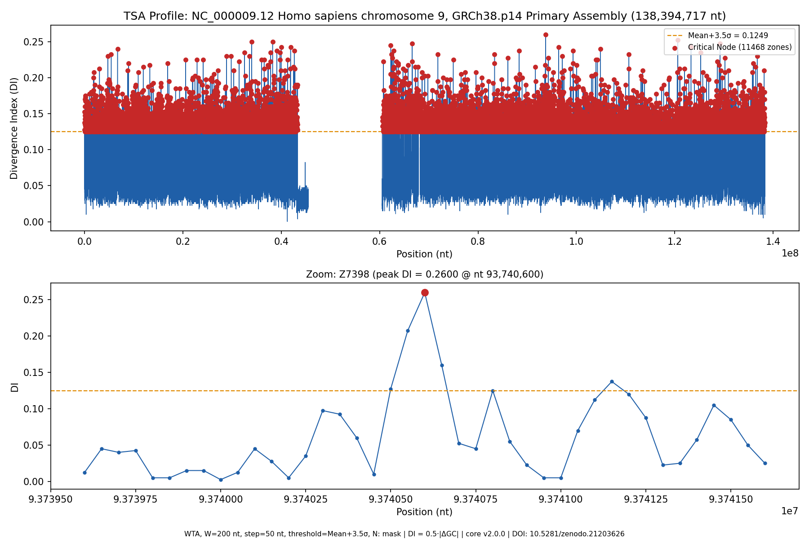
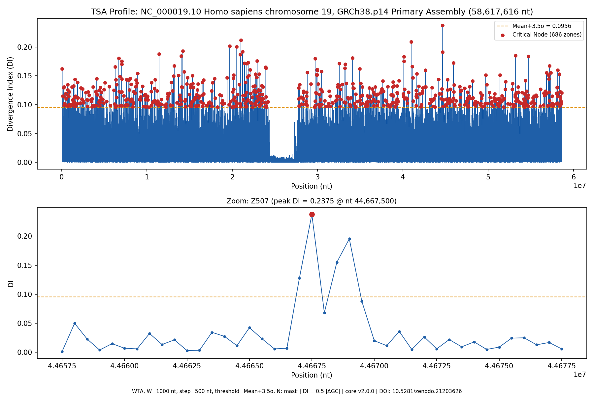
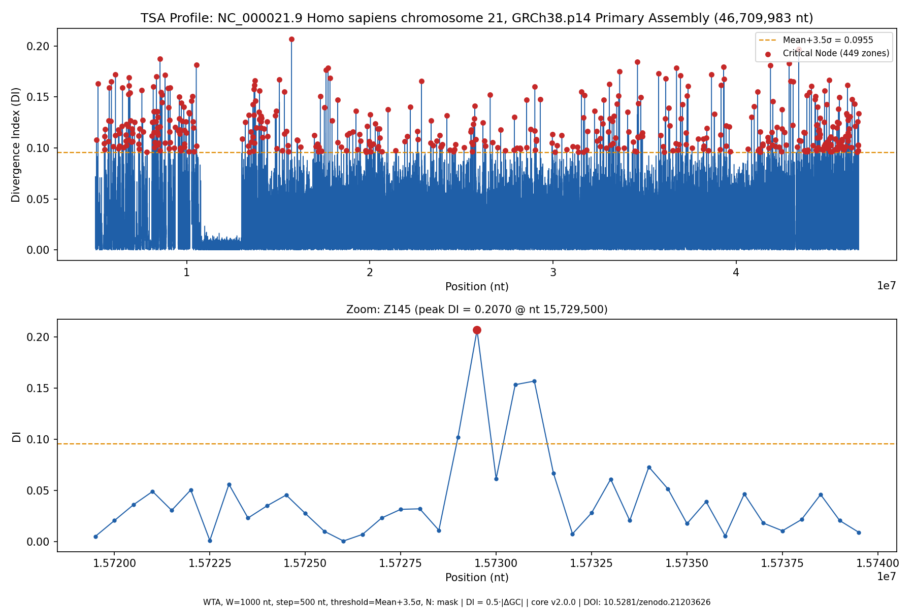

# 🧬 TENGRI STRUCTURAL ATLAS (TSA v2.0.0)

**Deterministic GC-Divergence Pre-filtering for Genomic AI Pipelines**

This atlas presents a standardized structural audit of major human autosomes using the upgraded TSA Engine v2.0.0. 

Unlike heavy probabilistic models (e.g., AlphaFold, ESMFold) that choke on chromosome-scale data due to O(N²) memory constraints, TSA is a deterministic pre-filter. It scans massive genomes in milliseconds, isolating Structural Conflict Zones (SCZ) — regions of extreme GC-divergence and tandem-repeat density that represent high-risk areas for downstream alignment or AI inference.

## 📊 Standardized Audit Summary

All audits were performed with the following locked parameters:
*   **Window (W):** 200 nt
*   **Step:** 50 nt
*   **Threshold:** Mean + 3.5σ
*   **N-Mode:** Masking (Ambiguous N-bases excluded from mean, windows >10% N masked)

| Chromosome | Length (bp) | N-Fraction | SCZ Zones Detected | Max Peak DI | Audit File |
| :--- | :--- | :--- | :--- | :--- | :--- |
| **Chr 1** | 248,956,422 | 7.42% | 20,637 | 0.2850 | [JSON](path_to_json) |
| **Chr 6** | 170,805,979 | 0.42% | 14,502 | 0.2400 | [JSON](path_to_json) |
| **Chr 9** | 138,394,717 | 12.00% | 11,468 | 0.2600 | [JSON](path_to_json) |
| **Chr 19** | 58,617,616 | 0.30% | 686 | 0.2375 | [Zenodo v4](https://doi.org/10.5281/zenodo.24244981) |
| **Chr 21** | 46,709,983 | 14.18% | 312 | 0.2641 | [Zenodo v4](https://doi.org/10.5281/zenodo.24244981) |

## 🖼️ Structural Profiles (Visualized)

Below are the TSA profiles for Chromosomes 1, 6, and 9. The red dots indicate the Critical Nodes (peak divergence) that breach the 3.5σ threshold. Notice how the signal density correlates with structural complexity and repeat regions.

### Chromosome 1

*(Length: 248.9 Mb · Peak DI = 0.2850 at nt 202,172,300)*

### Chromosome 6

*(Length: 170.8 Mb · Peak DI = 0.2400 at nt 1,652,350)*

### Chromosome 9

*(Length: 138.4 Mb · Peak DI = 0.2600 at nt 93,740,600)*

### Chromosome 19

*(Length: 58.6 Mb · Peak DI = 0.2375)*

### Chromosome 21

*(Length: 46.7 Mb · Peak DI = 0.2641)*

## 🛠️ How to Reproduce

The engine is fully open-source. You can generate these profiles locally in seconds.

```bash
# Clone the repository
git clone https://github.com/erjansarbaz/Tengri-Structural-Audit.git
cd Tengri-Structural-Audit

# Run the audit on your own FASTA file
python tsa_cli.py your_genome.fasta --out my_audit_report --n-mode mask
