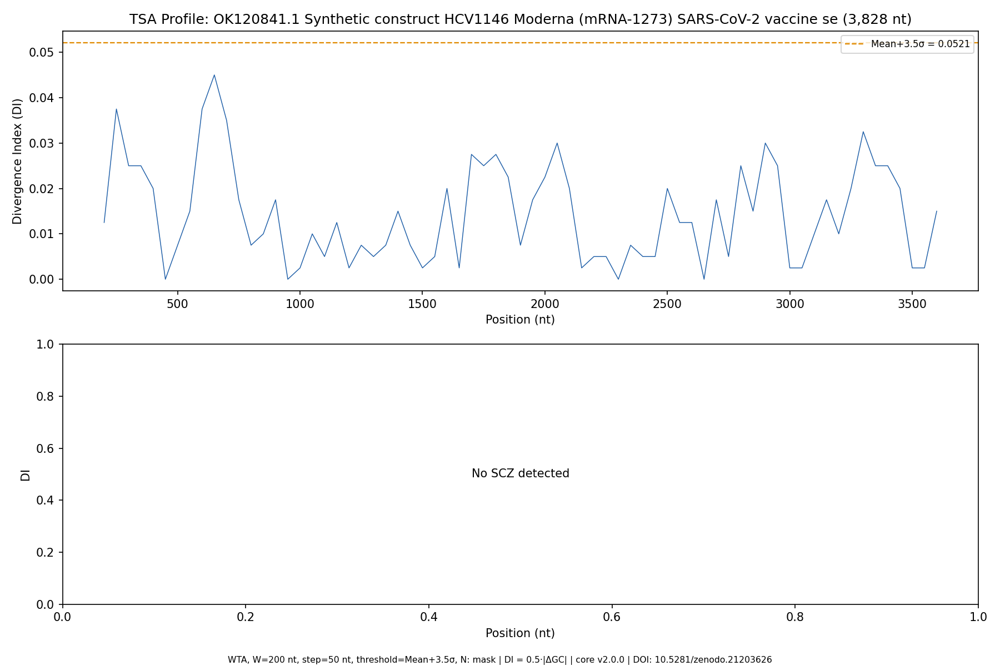
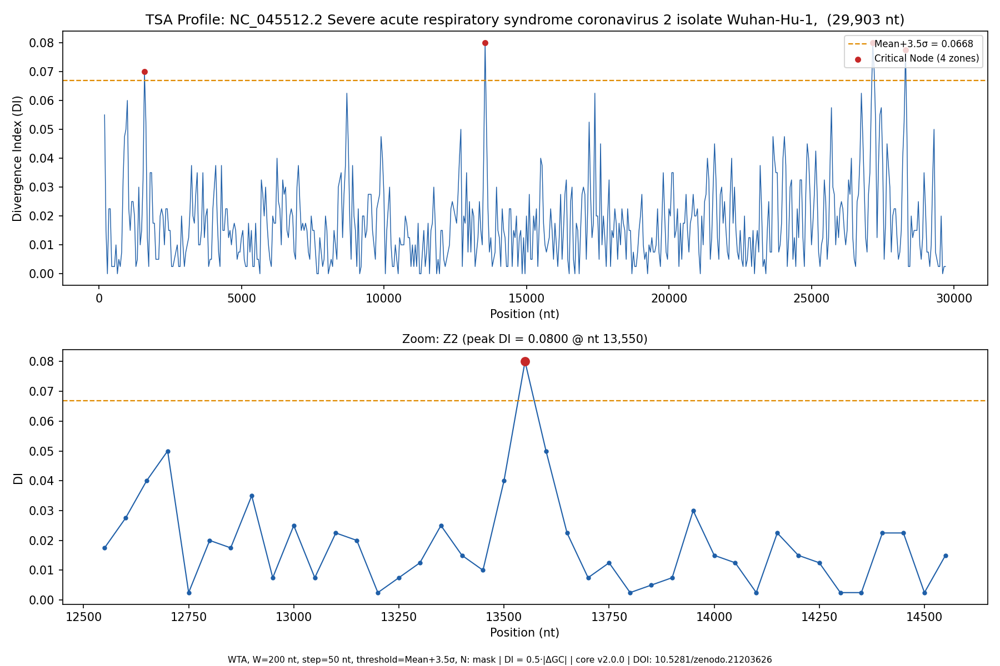

# 🦠 TENGRI VIRAL & VACCINE ATLAS

**Deterministic Structural Audit: Natural Chaos vs. Engineered Stability**

This atlas demonstrates the ability of the TSA Engine v2.0.0 to distinguish between natural evolutionary chaos and human bio-engineering, using a deterministic GC-divergence pre-filter (no AI, no training data).

## 🔬 The Experiment

We compared two sequences using locked parameters (W=200 nt, step=50 nt, Mean + 3.5σ):
1. **Wild-Type SARS-CoV-2 (Wuhan-Hu-1):** The natural viral genome (29,903 nt).
2. **Moderna mRNA-1273 Vaccine:** The heavily codon-optimized synthetic construct (3,828 nt).

## 📊 Key Findings

| Sequence | Length | SCZ Zones Detected | Max Peak DI | Interpretation |
| :--- | :--- | :--- | :--- | :--- |
| **Wild SARS-CoV-2** | 29,903 nt | **4** | **0.080** | Natural chaos. Isolated 4 structural conflict zones mapping exactly to protease boundaries and the Spike junction. |
| **Moderna Vaccine** | 3,828 nt | **0** | **0.045** | Engineered stability. Zero structural anomalies; sequence is mathematically smooth for optimal translation. |

## 🖼️ Structural Profiles (Visualized)

### 1. Moderna mRNA-1273 (Engineered Stability)

*Zero SCZ detected. The flat profile confirms the success of codon optimization.*

### 2. Wild-Type SARS-CoV-2 (Natural Chaos)

*Four SCZ peaks detected. The structural "fault lines" align with functional domains (e.g., viral proteases).*

## 🛠️ How to Reproduce

```bash
python tsa_cli.py your_sequence.fasta --out my_audit
📖 Citation & Code
Engine DOI: 10.5281/zenodo.24244981

GitHub Repo: Tengri Structural Audit

Developed by Erjan Baynazarov · Tengri Lab · 2026
